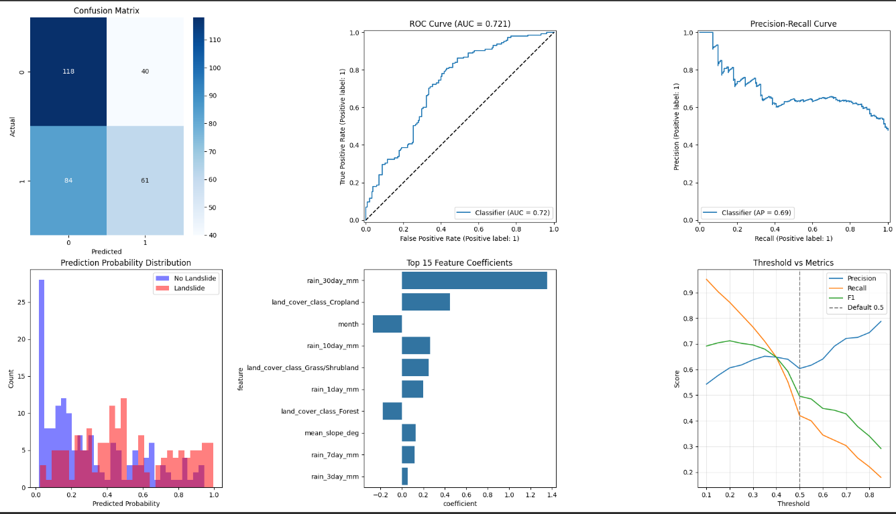

---
hide:
  - navigation
---

<style>
  .md-content .tw-lead-text { font-size: 1rem !important; }
  .md-content .tw-callout-panel { font-size: 0.9rem; border-left-color: #F7931E !important; }
  .md-content .tw-callout-panel strong { color: #F7931E; }
  .md-content .md-typeset h2 { color: #ffffff; font-size: 1.25rem; font-weight: 500; }
  .md-content .md-typeset h2::after { content: ""; display: block; width: 2.5rem; height: 3px; margin-top: 0.4rem; background: #F7931E; border-radius: 2px; }
  .md-content .md-typeset h3 { color: #F7931E; font-size: 0.95rem; }
  .md-content .md-typeset table:not([class]) { font-size: 0.72rem; }
  .md-content .tw-feature-card strong, .md-content .tw-step-body strong { font-size: 0.92rem; }
  .md-content .tw-feature-card span, .md-content .tw-step-body span { font-size: 0.82rem; }
</style>

# AI Risk Assessment

<p class="tw-lead-text">
  TerraWatch uses Logistic Regression to estimate landslide risk for a sector. It combines recent rainfall with relevant sector characteristics and returns a probability-based score that helps analysts decide where closer review may be needed.
</p>

<div class="tw-callout-panel">
  The score is a <strong>risk estimate</strong>, not a certainty or an official warning. Analysts review alerts and make decisions through the <a href="analyst-workspace.md">Analyst Workspace</a>.
</div>

---

## What Goes Into an Estimate

The prediction uses the latest rainfall observation provided for the sector. The model's input features include rainfall windows and, where required, sector characteristics.

| Feature | Meaning |
| :--- | :--- |
| `rain_1day_mm` | Rainfall accumulated over one day. |
| `rain_3day_mm` | Rainfall accumulated over three days. |
| `rain_7day_mm` | Rainfall accumulated over seven days. |
| `rain_10day_mm` | Rainfall accumulated over ten days. |
| `rain_30day_mm` | Rainfall accumulated over thirty days. |
| `month` | Calendar month of the observation. |
| `mean_slope_deg` | Mean slope recorded for the sector. |
| `land_cover_class` | Land-cover category recorded for the sector. |

Rainfall values come from the observation; month is derived from its timestamp. Sector characteristics are included when expected by the model.

---

## How a Prediction Is Made

<div class="tw-step-grid">
  <div class="tw-step-node">
    <div class="tw-step-badge">01</div>
    <div class="tw-step-body">
      <strong>Request</strong>
      <span>Send a sector ID and its timestamped rainfall observations.</span>
    </div>
  </div>
  <div class="tw-step-node">
    <div class="tw-step-badge">02</div>
    <div class="tw-step-body">
      <strong>Prepare</strong>
      <span>TerraWatch selects the latest observation and adds the sector features used by the model.</span>
    </div>
  </div>
  <div class="tw-step-node">
    <div class="tw-step-badge">03</div>
    <div class="tw-step-body">
      <strong>Estimate</strong>
      <span>Logistic Regression returns a probability between 0 and 1.</span>
    </div>
  </div>
  <div class="tw-step-node">
    <div class="tw-step-badge">04</div>
    <div class="tw-step-body">
      <strong>Review</strong>
      <span>The API records the estimate and its feature snapshot for the analyst workflow.</span>
    </div>
  </div>
</div>

Use `POST /analytics/models/{model_version_id}/predict-from-rainfall`:

```json
{
  "sector_id": "UUID",
  "rainfall_observations": [
    {
      "observation_time": "2026-09-27T03:00:00+03:00",
      "rain_1day_mm": 12.5,
      "rain_3day_mm": 24.0,
      "rain_7day_mm": 40.2,
      "rain_10day_mm": 51.0,
      "rain_30day_mm": 101.3
    }
  ]
}
```

The response includes `inference_id`, `risk_score`, `risk_level`, `prediction_time`, and `feature_snapshot_id`. `POST /analytics/inferences` records a prediction that has already been calculated; use the model-version prediction route above to run an estimate.

---

## Risk Levels

| Probability score | Level |
| :--- | :--- |
| ≥ 0.70 | EXTREME |
| ≥ 0.50 | HIGH |
| ≥ 0.25 | MODERATE |
| < 0.25 | LOW |

The score represents the model's estimated probability of landslide occurrence. It is not a separate confidence measure.

---

## Model Evaluation

The evaluation notebook, `logistic_regressor_training.ipynb`, combines rainfall, landslide inventory, land-cover, and sector terrain inputs to build 1,326 labeled samples: 442 landslide samples and 884 sampled non-landslide samples. It uses a temporal split at 2022-01-01: 1,023 training rows from before that date and 303 test rows from that date onward. The notebook's feature set includes month, the 1-, 3-, 7-, 10-, and 30-day rainfall windows, mean slope, and land-cover class.

| Test-set measure | Recorded result |
| :--- | :--- |
| Accuracy | 60.07% |
| ROC AUC | 0.7168 |
| F1-score | 0.5255 |
| Precision (landslide) | 0.61 |
| Recall (landslide) | 0.46 |

The figures above are the saved output of that notebook. The training workspace also contains the input files `TerraWatch_Sector_Rainfall_Matrix.csv`, `rwanda_minema_landslide_inventory_clean.csv`, and `LULC_TABLE_2017_2022.csv`, as well as `train_logistic_regression.py` and `train_rainfall_only.py`. These files are in the separate `chirps-historical-rainfall-datasets` workspace and are not included in this documentation-site repository.

The supplied performance image is a separate metrics snapshot. Its confusion matrix shows 118 true negatives, 40 false positives, 84 false negatives, and 61 true positives; from those counts, accuracy is 59.1%, precision 60.4%, recall 42.1%, and F1 49.6%. The plots report ROC AUC about 0.721 and average precision about 0.69. These threshold metrics differ from the notebook output above, so the image and notebook results should be treated as separate evaluation snapshots rather than combined into one result.

[](assets/images/logistic-regression-performance.png){ target="_blank" title="Open the full-size image" }
