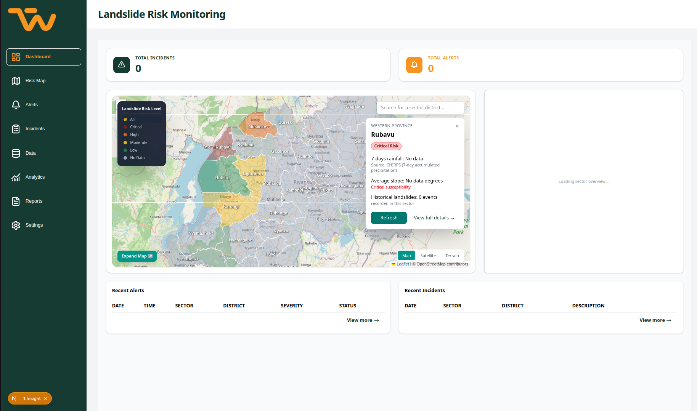

# Analyst Workspace

  The Analyst Workspace is where MINEMA analysts turn TerraWatch's risk estimates into decisions. In one place, an analyst can see which sectors are at risk, review the alerts raised by the model, record a decision, and log landslides reported from the field.

  The workspace supports decisions; it does not make them. A model output is a <strong>risk estimate</strong>, not an official warning. Every alert waits for an analyst's decision, and every decision is recorded with the analyst's name and the time.

---

## Dashboard

{ target="_blank" title="Open the full-size design" }

The dashboard brings together the four parts of the workspace:

| Area | What the analyst sees |
|---|---|
| **Risk map** | Sectors coloured by risk level, with a search box and a legend. |
| **Sector overview** | The selected sector's risk level, confidence and key drivers: recent rainfall, average slope and nearby past landslides. |
| **Recent alerts** | The newest alerts with time, sector, risk level and status. |
| **Recent incidents** | The newest field reports with date, location and description. |

---

## Daily Workflow

  

    
01

    

      <strong>Monitor</strong>
      Open the risk map and check which sectors show HIGH or EXTREME risk after the latest rainfall update.
    

  

  

    
02

    

      <strong>Review alerts</strong>
      Open each alert waiting for review and read the sector's rainfall, slope and history.
    

  

  

    
03

    

      <strong>Decide</strong>
      Approve, reject or dismiss the alert and add a comment explaining why.
    

  

  

    
04

    

      <strong>Log incidents</strong>
      Record landslides reported from the field so the history stays complete.
    

  

---

## Risk Map

The risk map shows every monitored sector of Rwanda's Western Province. Each sector is coloured by its latest risk level.

| Risk level | Meaning |
|---|---|
| **LOW** | No unusual risk. |
| **MODERATE** | Conditions to keep watching. |
| **HIGH** | Elevated risk. An alert is raised for review. |
| **EXTREME** | Very high risk. An alert with CRITICAL severity is raised for review. |

Selecting a sector opens its overview. Sectors are identified by both district and sector name, because some sector names exist in more than one district.

---

## Alerts

An alert is raised automatically when the model classifies a sector as **HIGH** or **EXTREME**. LOW and MODERATE results never create an alert, and only one alert can exist for each prediction.

| Risk level | Alert severity |
|---|---|
| HIGH | HIGH |
| EXTREME | CRITICAL |

### Alert lifecycle

Every new alert starts as **PENDING_REVIEW**. Its status changes only when an analyst records a decision.

| Status | Meaning |
|---|---|
| `PENDING_REVIEW` | Waiting for an analyst. |
| `APPROVED` | The analyst confirmed the risk and the alert should be acted on. |
| `REJECTED` | The analyst found the alert wrong, for example because of bad input data. |
| `DISMISSED` | The alert is valid but needs no action. |

The Alerts screen lists alerts newest first and can be filtered by status. Each row shows the date, district and sector, risk level, risk score, severity and status.

---

## Risk Reviews

A review is the analyst's recorded decision on an alert or directly on a prediction.

- The analyst chooses one decision: **APPROVED**, **REJECTED** or **DISMISSED**.
- A comment of up to 2,000 characters can explain the decision.
- The reviewer and the time are set by the system from the logged-in user. They cannot be typed in or changed.
- An alert can be reviewed **only once**. A prediction can be reviewed more than once, for example when new rainfall data arrives.
- Reviewing an alert also updates the alert's status to the decision.

---

## Incident Reports

Analysts log landslides reported from the field so TerraWatch keeps a complete record of real events.

### Reporting an incident

1. On the **Incidents** page, select **Report incident**.
2. Choose the **District**. The **Sector** list then shows only the sectors in that district.
3. Enter the **Event date**, which is when the landslide happened. It cannot be in the future.
4. Write a **Description** of what was observed.
5. Select **Submit**. The report appears at the top of the incidents table.

The form contains only these four fields. The reporter and the time the report was received are added by the system.

### Incidents table

Reports are listed newest first, with the date reported, event date, district and sector, description and the name of the analyst who reported it.

---

## Accountability

Every alert, review and incident report is written to the audit log in the same step as the change itself. Combined with the reviewer and reporter names stored on each record, this lets the team trace every decision back to a person and a time. See [Security & Compliance](security-compliance.md) for details.

---

## API Reference

The workspace screens use these backend endpoints. All paths start with `/api/v1`.

| Method | Endpoint | Purpose |
|---|---|---|
| `GET` | `/sectors` | List sectors for the map and the district and sector pickers |
| `POST` | `/alerts` | Raise an alert from a HIGH or EXTREME prediction |
| `GET` | `/alerts` | List alerts, newest first, with an optional `alert_status` filter |
| `GET` | `/alerts/{alert_id}` | Get one alert |
| `POST` | `/reviews` | Record a decision on an alert or a prediction |
| `GET` | `/reviews` | List reviews, newest first, filterable by alert or prediction |
| `POST` | `/incidents` | Log a field incident |
| `GET` | `/incidents` | List incident reports, newest first |
| `GET` | `/incidents/{report_id}` | Get one incident report |

### Common responses

| Code | When it happens |
|---|---|
| `201` | The alert, review or incident was created. |
| `401` | The user is not logged in, or the account is suspended. |
| `404` | The alert, prediction or report does not exist. |
| `409` | An alert already exists for the prediction, or the alert was already reviewed. |
| `422` | The request is invalid: a missing field, an unknown field, a future event date, an unknown sector, or a LOW or MODERATE prediction sent to create an alert. |
