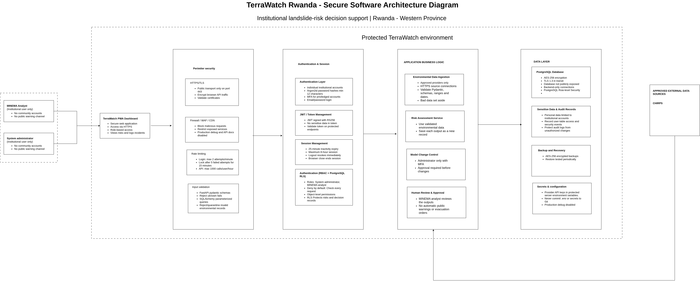

---
hide:
  - navigation
---

# Security & Compliance

  TerraWatch handles institutional accounts, landslide risk outputs and analyst decisions. A leaked account or a changed risk record could lead to a wrong decision during an emergency, so security is built into every layer of the platform: the dashboard, the API, the database and the hosting environment.

  This page follows the Codebine Security Requirements and the Secure Software Architecture Document (SSAD). Each control is marked as <strong>In place</strong> (already in the code) or <strong>Planned</strong> (agreed in the requirements and being built).

---

## Secure Architecture (SSAD)

The diagram shows where each control sits, from the analyst's browser to the database. Select the image to open it at full size.

{ target="_blank" title="Open the full-size diagram" }

---

## Who Uses the System

TerraWatch is an institutional platform. There are no public or community accounts.

| Role | What the role can do |
|---|---|
| **System Administrator** | Onboards analysts, suspends or reactivates accounts, and manages model and threshold settings. |
| **MINEMA Analyst** | Views the risk map, reviews alerts and predictions, and logs field incident reports. |

Every user has an individual account stored in the `users` table, with a role (`ADMIN` or `ANALYST`) and an account status (`ACTIVE` or `SUSPENDED`). An administrator creates analyst accounts; users cannot register themselves.

---

## Security Controls

### Authentication

| Control | How it works | Status |
|---|---|---|
| Individual accounts | One account per person, email and password; no shared accounts. | In place (`users` table) |
| Password storage | Passwords are hashed with Argon2id and never stored in plain text; minimum length is 12 characters. | Planned |
| Multi-factor authentication | Required for administrators and other privileged accounts. | Planned |
| Brute-force protection | Login attempts are rate-limited, and an account is locked for 15 minutes after 5 failed attempts. | Planned |
| Suspended accounts | A suspended user cannot use the API, even with a valid session. | In place |

### Authorization

| Control | How it works | Status |
|---|---|---|
| Role-based access control | Permissions are checked on every request in the FastAPI backend, and access is denied by default. | Planned |
| Object-level checks | A user can open only the records their role allows. | Planned |
| Row-Level Security | PostgreSQL Row-Level Security backs the API checks for risk assessments and decision records. | Planned |
| Server-owned fields | Fields such as `reported_by`, `reviewed_by`, `reported_at` and `reviewed_at` are set by the server from the logged-in user and the clock. A request that tries to send them is rejected. | In place |

### Tokens and Sessions

| Control | How it works | Status |
|---|---|---|
| Login token | Every protected endpoint needs a JWT signed with RS256. The token holds no sensitive data. | Planned |
| Session expiry | The session expires after a period of inactivity and has a maximum length; closing the browser ends it. | Planned |
| Logout | Logging out cancels the session immediately. | Planned |

!!! note "Login during development"
    Until the authentication feature is merged, the backend uses a development-only setting (`DEV_USER_ID`) that stands in for the logged-in user. It is rejected for suspended users and is **never set in production**.

### API Security

| Control | How it works | Status |
|---|---|---|
| Strict input validation | Every request body is checked by Pydantic for type, format and range. Unknown fields are rejected with HTTP 422. | In place |
| Business rules on the server | Rules such as "an event date cannot be in the future" or "only HIGH and EXTREME predictions can raise an alert" are enforced in the service layer, not only in the browser. | In place |
| SQL injection protection | All database access goes through SQLAlchemy with bound parameters; there is no raw SQL built from user input. | In place |
| Generic errors | Users see a short message. Passwords, keys, tokens, stack traces and database details are never returned. A reference number on each error is planned. | Partly in place |
| Rate limiting | Login attempts and API calls per user per hour are limited. | Planned |

### Data Protection

| Control | How it works | Status |
|---|---|---|
| Encryption in transit | All traffic uses HTTPS with TLS. | In place (hosting) |
| Encryption at rest | The PostgreSQL database and its backups are encrypted with AES-256. | Planned |
| Secrets management | Database URLs and Earth Engine keys are kept in server environment variables and are never committed to Git (`.env` is in `.gitignore`). | In place |
| Approved data sources | Rainfall data is fetched only from approved providers (CHIRPS through Google Earth Engine) over HTTPS. | In place |
| Data checks | Rainfall cannot be negative, dates cannot be in the future, and bad records are not stored. | In place |
| Backups | Encrypted backups are kept for 30 days, with a copy at a second Rwanda-based site. | Planned |

---

## Audit Trail

Every important action is recorded in the `system_audit_logs` table, so the team can always answer **who did what, and when**.

| Action | Audit entry |
|---|---|
| An alert is raised from a high-risk prediction | `EMERGENCY_ALERT_CREATED` |
| An analyst approves, rejects or dismisses an alert or prediction | `RISK_REVIEW_CREATED`, with the reviewer and the decision |
| An analyst logs a field incident | `INCIDENT_REPORT_CREATED` |
| Rainfall data is synced from CHIRPS | A rainfall sync entry |

The audit entry is saved in the **same database transaction** as the change it records. If the change fails, no audit entry is written, and an action can never be saved without its audit entry. Audit entries never contain passwords, tokens or keys.

---

## Human Decision Boundary

TerraWatch supports decisions; it does not make them.

- The model produces a **risk estimate**, not an official warning.
- A high-risk prediction creates an alert with the status `PENDING_REVIEW`.
- Only an analyst can approve, reject or dismiss it, and the decision is stored with the reviewer's name and time.
- The system cannot issue public warnings by itself.

---

## Privacy

| Principle | How TerraWatch applies it |
|---|---|
| Purpose | Personal data is used only for login, access control, administration, security monitoring and accountability. |
| Data minimization | The `users` table holds only name, institutional email, role, account status and timestamps. No community personal data is collected. |
| Access | Only system administrators can see user details. |
| Sharing | Personal data is not shared with third parties without an approved institutional or legal reason. |
| Retention and deletion | Account data is kept while the account is active and for 3 months after deactivation, then deleted or anonymized so audit records stay valid. |

---

## Compliance

| Standard or policy | How it applies to TerraWatch |
|---|---|
| **Rwanda Law No. 058/2021** on the protection of personal data and privacy | Applied through the privacy controls above: collect only what is needed, use it only for the stated purpose, store it in Rwanda, encrypt it and follow the retention periods. A privacy review is done before deployment. |
| **ISO/IEC 27001** | Used as a guide for access control, encryption, audit logging, backups, supplier checks and testing. |
| **MINEMA and hosting cybersecurity policies** | Reviewed with the MINEMA or hosting cybersecurity team before deployment. |

---

## Security Testing

| Test | What it checks | Tools |
|---|---|---|
| Automated API and unit tests | Validation, rejected fields, server-owned fields, audit entries and database rules. Run on every pull request and before each deploy. | pytest, FastAPI TestClient |
| API security testing | Authentication, authorization, input validation, rate limiting and token handling, using the OWASP API Security Top 10 as the checklist. | Postman, Burp Suite Community |
| Dependency scanning | Known vulnerabilities in Python and JavaScript libraries. | pip-audit, npm audit |
| Data-ingestion testing | Negative rainfall, wrong formats, future dates, duplicates and missing values. | pytest |
